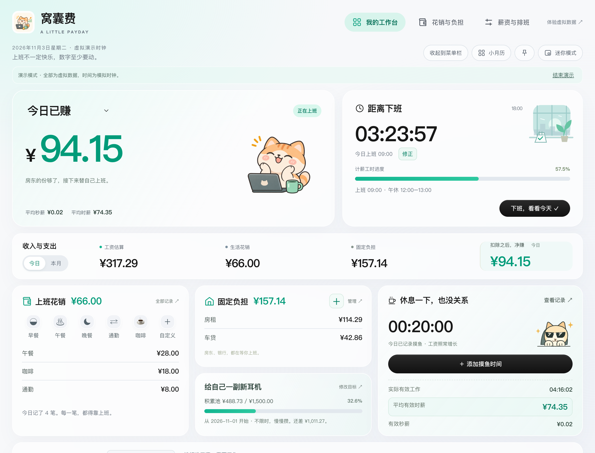

# 窝囊费

本地桌面计薪与上班成本记录工具。当前源码为桌面 0.3.3 和网页版 0.4.3，使用薄荷毛玻璃界面，支持 996 与全年无休，数据保存在本机，无需账号或业务联网。



## 本轮源码更新

日历支持未来单日排班、请假/调休、历史补录和净利润格内展示；修正直接编辑上下班，多段返工全部展开。运行中忘记点下班也可补填真实结束时间，保存前预览，保留原时段、摸鱼和加班费。单日计划不改变基础计薪分母，未来不提前记收入/工时；休息日无薪加班参与实际工时和本月净均薪。详见 [日历规则与迁移](docs/CALENDAR.md)。

工资统一输入到手金额，保存时可选今天或明天生效；今天重算当前日期的工资、净额及目标池，旧日期和额外加班费保留。首次上班默认按当天设定开始时间补算，扣午休，下班封顶；返工保留休息间隔，重叠已有工时不重复计入。演示模式已移除，旧演示档案原样保留、不混入个人账本。详见 [本轮规则与兼容](docs/SALARY-START.md)。

独立网页版在 [web/](web/README.md)，浏览器使用 IndexedDB 和 JSON 备份，不依赖 Electron。进入 web 后执行 `npm test`、`npm run build`、`npm start` 即可本机体验。网页生产部署另行执行，本轮没有操作 Vercel 或 DNS；[部署与回退说明](web/DEPLOYMENT.md)。

## 下载与系统

[下载 v0.3.3 预发布安装包](https://github.com/zhounuo528/wonangfei/releases/tag/v0.3.3)。旧 v0.3.0 与 v0.2.1 保留，不覆盖旧附件。

| 文件 | 适用设备 | 最低系统 |
| --- | --- | --- |
| `Wonangfei-Setup-0.3.3-x64.exe` | Windows x64 | Windows 10 |
| `Wonangfei-0.3.3-mac-x64.dmg` | Intel Core i5/i7/i9 Mac | macOS 13 |
| `Wonangfei-0.3.3-mac-arm64.dmg` | Apple Silicon / M 系列 Mac | macOS 13 |

Mac App 仅 ad-hoc 临时签名，未做 Developer ID 签名或 Apple 公证，DMG 未签名；Windows App 和安装器未签名。下载后可能被 Gatekeeper/SmartScreen 拦截，不要求关闭或绕过系统安全设置。

Mac 打开 DMG 后将应用复制到 Applications；Windows 运行向导，只为当前用户安装。先退出旧版并导出升级前 JSON 备份；沿用原数据目录，回退旧版须配合升级前备份。详见 [安装、签名与回退](docs/INSTALLATION-0.3.3.md)。

## 功能

- 双休、单休、大小周、996、全年无休。996 默认周一至周六 09:00–21:00，可调整；全年无休每天为工作日，时间自设。月薪默认除以当月考勤计划工作日得到日薪，可手动调整本月；完整记录相同设置下一个月的计划工时后，基础工资等于设定月薪。
- 真实时间戳计薪，首次点击按当日设置开始补算，扣除午休，前台流畅刷新，所有钱显示两位小数。关闭、隐藏或休眠后按时间戳恢复；工资到设定下班时间封顶。
- 今日主金额为工资减成本；负数红色「今日还欠」，回本后「今日已赚」。可切换本月工资毛收入、目标进度或隐藏金额，猫咪有开心、焦虑和加班痛苦状态。
- 临时当日花销、整月自定义花销、月/季/年固定负担。整月与固定成本按考勤工作日分摊，未来份额不提前计入月累计；已有分摊表保留原规则。
- 摸鱼默认 15 分钟，±5、长按或直接输入。工资不减少，有效工时扣除摸鱼；超过当前可计入时长会提示，零分母不计算。
- 今日平均秒薪、时薪使用今日工资除有效工时；本月平均秒薪、时薪使用本月净收入除有效工时，平均日薪使用净利润除有正工时的记录天数。消费换算达到一天工时后以工作日天数显示。
- 上下班时间直接修正，带影响预览、原始记录审计和安全撤销，同步重算日历、总结、月报与目标。未编辑时段保留原始秒和毫秒。
- 不限时净收入目标池，亏损负向扣减；完成目标扣一次金额，余款留给下一目标。旧目标保留名称金额，从升级当天开始积累。
- 到点原倒计时切为红色「已加班」正向计时，工资停止自动上涨、平均时薪下降。下班后可「起来加班」，休息间隔不计工时；累计加班严格超过两小时再下班时，可记本次加班费或免费加班。
- 下班总结、实际记录月历、月末回顾和可选应用内下班提醒。没有点击开始的日期不补算出勤或工资。
- Mac 原生菜单栏、迷你窗口与置顶。菜单栏需在完成设置后主动点击「收起到菜单栏」，重启不会自动恢复收起状态；Windows 原生托盘尚未适配。

## 历史与数据

首次保存新的日历或上下班修正会把个人记录格式升级至 2。新版兼容旧格式，旧版拒绝格式 2；升级前导出备份，回退旧程序必须使用升级前备份，不能只回滚静态文件或强改版本号。目标池允许负数，已完成结算保留，不重复加钱。

每个已记录日期保留当时薪资/排班快照，固定费用和整月费用保留考勤快照或日期表。改模式不静默重写旧记录；需要新固定规则时停止旧项再新增。跨日返工归原班次，计划排班本身只支持同日。不自动套用法定节假日或调休。

打包版数据目录：Mac `~/Library/Application Support/WonangfeiTrial/`，Windows 用户 AppData 下的 `WonangfeiTrial/`；开发版为项目 `.local-data/`。只使用个人档案；旧演示文件保留但不再激活。本地 JSON 为明文，可在设置导出备份。仓库和安装包不包含个人档案、运行测试档案、缓存或凭据。

## 开发与验证

需要 Node.js 22.12+。在克隆目录中运行：

```sh
npm ci
node node_modules/electron/install.js
npm test
npm start
npm run smoke
npm run smoke:calendar
```

当前桌面源码 141 项单元测试、网页 143 项单元测试，分别在 UTC、上海、纽约通过；日历真实界面桌面 20 组、网页 19 组通过，工资与存储回归桌面 15 组、网页 17 组通过。只使用虚拟数据。`npm run smoke` 自动使用新临时虚拟档案，旧 GUI 脚本保留作历史证据。安装包当前为 0.3.3；两份最终 DMG 复制出的 arm64 原生应用和 x64 Rosetta 应用各通过 35 组打包检查。本轮没有生产网页部署。

0.3.0 安装包的独立验证记录保留在 [旧版验收](docs/VALIDATION-0.3.0.md)，不能等同于当前源码打包验证。当前源码检查范围见 [日历验收汇总](docs/CALENDAR-VALIDATION.json)，旧版验收按原日期保留。Intel 硬件、macOS 15.x、Windows 安装运行、物理 Finder/Dock/菜单栏点击、Safari/Firefox 和实体手机仍未完成本轮验收。

[构建方法](docs/BUILDING.md)和[迁移评估](docs/PORTABILITY.md)保留。构建脚本只接受正式 x.y.z 版本并拒绝覆盖已有产物。

Latest packaged validation: [v0.3.3 matrix](docs/VALIDATION-0.3.3.json). Native arm64 and x64-under-Rosetta are distinct from Intel hardware testing.
